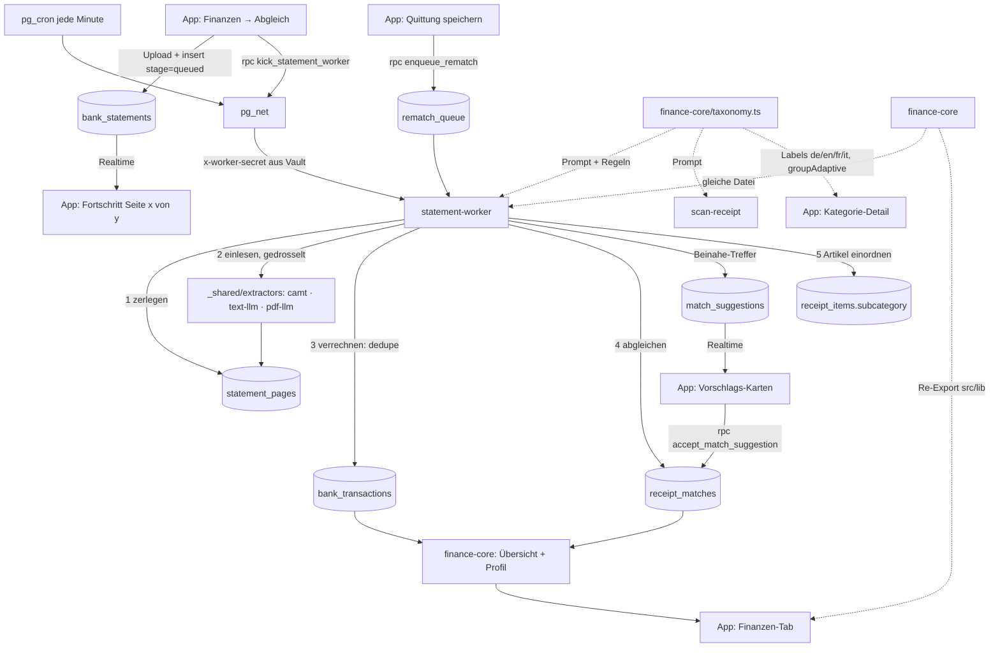

# ARCHITECTURE.md — Piggy

> **LLM-Hinweis:** Lies diese Datei und `docs/adr/` vor Änderungen an Finanzlogik, Kontoauszug-Pipeline, Abgleich oder Kategorien. Dokumentiert Kopplungen, die bei Änderungen mitgezogen werden müssen.

## Intent & Constraints

**Ziel:** Quittungen scannen + Kontoauszüge importieren = komplette Finanzübersicht. Bank-Ausgaben werden über verknüpfte Quittungen bis auf Artikel-Ebene kategorisiert; Ungereimtheiten (Trinkgeld, Fremdwährung, Rabatt) werden als Vorschläge angeboten.

| Constraint | Begründung |
|-----------|-----------|
| Finanzlogik nur in `supabase/functions/_shared/finance-core/` | App (Metro/Jest) und Edge Functions (Deno) nutzen dieselbe Quelle; `src/lib/{categories,finance,matching,discrepancies,profile}.ts` sind reine Re-Exports |
| In `finance-core` und `extractors`: relative Imports mit `.ts`, keine npm/RN/Supabase-Imports | Deno verlangt Endungen; App kompiliert dieselben Dateien (`allowImportingTsExtensions`) |
| Kontoauszüge werden nur serverseitig verarbeitet (statement-worker) | Grosse PDFs (10–40 Seiten, ~1000 Buchungen) sprengen ein synchrones Edge-Limit und dürfen nicht an offener App hängen (ADR 0001) |
| Pro Artikel genau eine Hauptkategorie (`receipt_items.tags[0]`) + optional eine Unterkategorie (`receipt_items.subcategory`) | Taxonomie in `finance-core/taxonomy.ts` (ADR 0002); Hauptkategorie-ID = stabiler deutscher Name in der DB, Anzeige-Labels pro Sprache; Alt-Tags über `LEGACY_TAG_CATEGORY` |
| Unterkategorie muss zur Hauptkategorie gehören | `resolveSubcategory` (App) bzw. `resolveClassification` (Worker) prüfen das vor jedem Schreiben |
| Umbuchungen zählen nie als Ausgabe/Einnahme | Kreditkarten-Rechnung vom Konto + Kreditkarten-Auszug wären sonst doppelt |
| Secrets nie im Code: Worker-Auth über Vault (`statement_worker_secret`), LLM-Key als Function-Env | Cron/App rufen den Worker, ohne den Service-Key zu kennen |

## Dependency & Contract Matrix

| Komponente | Triggert durch | Output | Hard Dependencies |
|-----------|--------------|--------|------------------|
| `app/scan.tsx` | User speichert Quittung | `receipts`, `receipt_items` (tags + subcategory), RPC `enqueue_rematch` | `src/lib/ocr.ts` → `normalizeItems` (gültige Unterkategorie bestimmt die Hauptkategorie) |
| `app/duplicates.tsx` / `DuplicateReceiptReview` | User prüft zwei Belege oder neuen Scan | explizite Vorschau und Entscheidung; RPCs `merge_receipt_duplicates`, `merge_receipt_scan`, `save_separate_receipt_scan`, `keep_receipts_separate`, `delete_reviewed_receipt` | `finance-core/receipt-duplicates.ts`; transaktionaler Beziehungserhalt und private Audit-Historie (ADR 0003); keine automatische Zusammenführung |
| `scan-receipt` (Edge) | OCR-Text aus der App | Quittungs-JSON mit `tags` + `subcategory` je Artikel | Prompt aus `taxonomy.receiptItemCategoryPrompt()` — gleicher Abschnitt im Gemini-BYOK-Prompt (`ocr.ts`) |
| `app/receipt/[id].tsx` | User bearbeitet Artikel | `receipt_items` mit `classified_at = now()` | Hintergrund-Einordnung fasst geprüfte Artikel nie mehr an |
| `src/hooks/useBankStatements.ts` | Upload im Finanzen-Tab | Storage `bank-statements/{uid}/…`, `bank_statements(stage=queued)`, RPC `kick_statement_worker` | KI-Einwilligung (`aiConsent`) vor Upload |
| `statement-worker` (Edge) | pg_cron jede Minute, Kick | `statement_pages`, `bank_transactions`, `receipt_matches`, `match_suggestions`, Fortschritt in `bank_statements` | RPCs `claim_*` (SKIP LOCKED), `app_settings.statement_*`, `_shared/extractors`, `_shared/finance-core` |
| `_shared/extractors` | Worker pro Seite | `ParsedLine[]` + Tokens/Modell | `ANTHROPIC_API_KEY`; Modelle aus `app_settings` |
| `_shared/classify/items.ts` | Worker Schritt 5 (wenn Zeit übrig) | `receipt_items.subcategory`, ggf. korrigierte Hauptkategorie | RPC `claim_items_to_classify` (subcategory IS NULL AND classified_at IS NULL); `RELATED_MOVES` begrenzt Kategorie-Wechsel |
| `finance-core/matching.ts` | Worker (Abgleich) | exakte 1:1-Treffer | Score Betrag 50 / Datum 30 / Händler 20, Schwelle 0.6 |
| `finance-core/discrepancies.ts` | Worker nach Abgleich | Vorschläge tip/fx/discount/partial/other | nutzt `dateScore`/`merchantScore`/`scoreMatch` aus matching |
| `finance-core/finance.ts` / `profile.ts` | Finanzen-Tab | Monatsübersicht, Finanzprofil (Woche/Monat) | Kategorien aus `categories.ts`; `buildPeriodOverview` ist die einzige Summenlogik |
| RPC `accept_match_suggestion` | User übernimmt Vorschlag | Verknüpfung + Ausgleichsposten (`receipt_items.is_adjustment`) | SECURITY INVOKER → RLS des Users |

## Mermaid Dependency Graph

## Invariants

1. **Eine Quelle für Finanzlogik** — nie Logik in `src/lib/*` duplizieren; neue Funktion in `finance-core` + Re-Export.
2. **Claims immer über RPC mit `FOR UPDATE SKIP LOCKED`** — Cron und Kick laufen parallel.
3. **Verrechnen dedupliziert gegen alle Buchungen im Zeitraum (paginiert)** — Re-Import oder Retry darf nie doppelte Buchungen erzeugen.
6. **Vorzeichen per Saldo-Kette korrigieren** (`extractors/balance.ts`) — der Text-Layer verliert die Soll/Haben-Spalte; vor dem Verrechnen läuft die Kette seitenübergreifend.
7. **Plausibilität pro Seite** — liefert das Text-Modell < 75 % der Datumszeilen, wird die Seite per Vision (pdf-llm) nachgelesen; Rohausgabe steht in `statement_pages.raw_output`.
8. **Keine stillen Zeilenverluste** — eine Datenzeile der Modell-Antwort, deren Betrag nicht lesbar ist, lässt die Seite scheitern (`parseStrict`): auto → Vision-Fallback, sonst Retry und sichtbarer Fehler. `parseAmount` versteht Unicode-Minus, nachgestelltes Minus und Klammern.
9. **Vom User geprüfte Artikel bleiben, wie sie sind** — `classified_at` gesetzt ⇒ kein Hintergrund-Reklassifizieren.
4. **Vorschläge werden nie automatisch angenommen** — nur User-Aktion (`accept_match_suggestion`); abgelehnte Paare werden nie erneut vorgeschlagen (UNIQUE `transaction_id, receipt_id`).
5. **Original-Total einer Quittung bleibt unverändert** — Differenzen nur als `is_adjustment`-Artikel.

10. **Duplikate nur nach expliziter Bestätigung** — Bild, Felder und genau eine normale Artikelliste werden gewählt; Bank-, Split-, Sharing- und Projektbeziehungen bleiben erhalten oder blockieren bei Konflikten. Eingehender Scan wird beim Merge nie als zweite Ausgabe angelegt (ADR 0003).

## Refactoring-Guides

### Anderes LLM / effizienteres Einlesen
1. Nur Modell tauschen: `app_settings.statement_text_model` / `statement_pdf_model` ändern (kein Deploy).
2. Neues Verfahren: Extractor in `_shared/extractors/` (Interface `ExtractResult`), in `index.ts` registrieren, `statement_extractor` setzen; Worker neu deployen.
3. Kosten/Qualität vergleichen über `statement_pages.extractor, model, tokens_in, tokens_out, ms`.

### Drossel / Last anpassen
`app_settings.statement_pages_per_tick`, `statement_page_concurrency`, `statement_max_attempts`; Takt in `cron.job` (`statement-worker`).

### Neue Unterkategorie / Kategorie umbenennen
1. `finance-core/taxonomy.ts`: Eintrag mit Art (essential/treat/occasional), Labels in allen 4 Sprachen **sinngemäss** (nicht wörtlich), optional Regex.
2. Hauptkategorie-ID nie umbenennen (steht in der DB) — nur `label` ändern. Neue Hauptkategorie: Eintrag + ggf. `CLASSIFY_ORDER`, `RELATED_MOVES`, Worker-Prompt-Hinweis.
3. `src/lib/taxonomy.test.ts` ergänzen; scan-receipt **und** statement-worker neu deployen (beide bündeln die Taxonomie).
4. Bestehende Artikel neu einordnen: `update receipt_items set subcategory = null, classified_at = null where …` → Worker übernimmt.

### Neue Vorschlags-Art
`discrepancies.ts` (+Test) → CHECK-Constraint `match_suggestions.kind` + `accept_match_suggestion` (Label/Kategorie) → `SuggestionCard` Texte.

## Receipt capture subprocess

The iOS camera uses `modules/piggy-receipt-scanner` (AVFoundation/Vision), with a shared explicit review/confirmation state for automatic and manual captures. `useScanner` waits for the source sheet to dismiss before presenting it and waits for native dismissal before routing to OCR. The native module must be included in a rebuilt app; an OTA update cannot add it. Detailed lifecycle, incident evidence, active parser path and physical-device acceptance are in `.kdev/partials/receipt-scan.md`; navigator stages in `.kdev/flow.json`.

## Monetarisierung: Gold und Werbung

`SubscriptionProvider` hält den pro Konto abgegrenzten RevenueCat-Status für Paywall, `PiggyWordmark` und Werbung. Öffentlicher Name **Piggy Gold**, technische Kennungen weiterhin `plus`, Offering `default`, Route `/plus`; diese nicht ohne Bestandskunden-/Webhook-Migration umbenennen. Monats-/Jahrespreise kommen ausschliesslich aus dem Store. Ein fehlgeschlagener Statusabruf ist `resolved=false` und erlaubt keine Werbung.

`AdsProvider` lädt Google Mobile Ads erst nach Rolloutkonfiguration, bestätigtem Gratisstatus, eigener Wahl und Google UMP (`canRequestAds`). Native Appmessung wird über `app.config.js` verzögert. Werbeanfragen enthalten keine Beleginhalte oder Piggy-User-ID. `scan.tsx` ruft den Werbeschritt erst **nach** erfolgreichem Speichern eines neuen Belegs auf; Merge, Kamera, OCR und Review sind keine Anzeigenplätze. Geladene Interstitials folgen den Regeln in `adPolicy.ts`; ohne Anzeige bleibt der Speicherablauf erfolgreich. Goldstatus wird vor Präsentation nochmals geprüft. Banner sind optional, keine Overlaynavigation.

Launchkonfiguration, Datenflussmeldung und noch offene echte Geräte-/Storeabnahme: `docs/PIGGY-GOLD-LAUNCH.md`. Ein neuer nativer Build ist erforderlich. Ein OTA-Update kann das neue native SDK nicht bereitstellen.

## Nativer iPhone-Client (Umsetzung)

`native/Piggy` enthält den neuen SwiftUI-Client; Entscheidungen und offene Validierung stehen in [ADR 0004](docs/adr/0004-native-swiftui-client.md). `Sources/Core` ist ein Foundation-Package, `Services` nutzt Supabase, `Screens` und `Onboarding` sind native SwiftUI-Ansichten. Finanzsummen kommen über den neuen Adapter `supabase/functions/native-finance` aus dem bestehenden kanonischen finance-core. `Resources/Brand/provenance.json` dokumentiert alle importierten K-Creative-Laufzeitassets. Neue Swift-Dateien erfordern `scripts/generate_project.py`; neue Brand-Exporte `scripts/sync_brand.py` und `scripts/validate_resources.py`.

## Dateispeicher: R2, Auth und Datenbank: Supabase

Seit 25.11.2026 liegen die bisherigen 333 Dateien auch im privaten EU-R2-Bucket `piggy-receipts`. `storage-url` prüft Supabase-Nutzertokens und eigene Dateipfade und stellt kurzlebige S3-URLs aus. Swift `ObjectStorageService` und Expo `objectStorage` laden neue Dateien nur nach R2; `r2-with-fallback` erlaubt lediglich alte Dateien aus Supabase zu lesen. `statement-worker` liest über den gemeinsamen Storage-Adapter; `delete-account` entfernt Nutzerdaten aus beiden Dateispeichern. R2-Schlüssel bleiben im Backend. DB-Pfade und Nutzerkonten sind unverändert. Installierte Altversionen brauchen ein Update; vor Abschalten der Supabase-Kopie erneut synchronisieren. Siehe [ADR 0005](docs/adr/0005-belege-auf-r2.md) und [Verifikation](docs/verification/2026-11-25-r2-storage.md).

## Firmen-Spesen (vorbereitet, deaktiviert)

ADR [0006](docs/adr/0006-company-expense-pilot.md) beschreibt den neuen Firmenbereich. SwiftUI `CompanyViews` → `CompanyService` → RPC `company_workspace` übernimmt Firma, Mitgliedschaft, Einreichung und Prüfung. Edge `company-expenses` archiviert Originalbilder unter separatem R2-Präfix und bestätigt deren Hash über die nur für den Service erreichbare RPC `company_archive_complete`. Snapshot, Ereignisse und Export werden serverseitig festgehalten. Ein neutraler JSON-Export ist keine Abacus-Übertragung und keine Auszahlung.

`PIGGY_COMPANIES = NO` bleibt Standard. Migration und Edge Function sind noch nicht live ausgerollt. Vor Aktivierung muss insbesondere der Konflikt zwischen unveränderlicher Firmenhistorie und bestehender Konto-Löschung gelöst werden; weitere Abnahmeschritte und Partnerdossier: [Firmenpilot](docs/ABACUS-COMPANY-PILOT.md).

## Share-Eingang, Anbieterinfos und Coupons

Siehe [ADR 0007](docs/adr/0007-share-inbox-personal-library.md). Haupt-App und eingebettete Share Extension teilen den lokalen `ShareInbox`-Vertrag. Die Haupt-App übernimmt Dateien erst nach Prüfung als Finanzbeleg oder als getrennten Coupon. Original-PDFs liegen nach bestätigtem Belegspeichern privat im vorhandenen Objektspeicher und werden über interne Zusatzfeld-Referenzen erhalten. Diese Referenzen müssen bei Merge, Export, Konto-Löschung und einer späteren Firmenarchivierung berücksichtigt werden. Persönliche Logos/Kataloglinks und Coupons sind zunächst lokal und nach Konto getrennt. Der lesende SumUp-Adapter ist eine vorbereitete Serverkomponente, noch kein deployter Hintergrunddienst. Apple-Signierung/Setup und konkrete Nutzung: [Setup-Handbuch](docs/SHARE-LOGOS-COUPONS-SUMUP.md).
